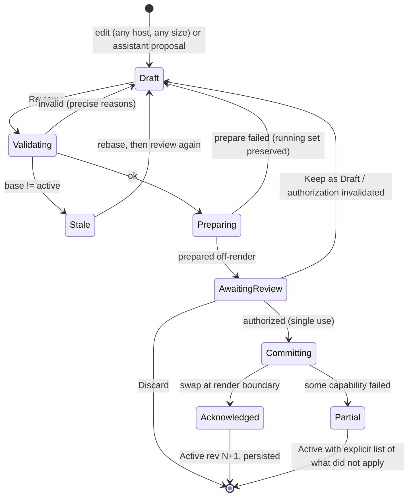

# Draft versus Active Transactions

Owner: #62 host-authority-transactions (draft ops #54, wiring diffs #101, review container #99,
assistant drafts #37/#119). Examples: `transactions.json`, `commands.json`, `graph.json` and
`project.json` histories.

## Lifecycle



## Steps

| Step | What happens | Never | Example |
|---|---|---|---|
| validate | Types, direction, channel conversion, cycles only via feedback, capabilities, base revision | Mutates anything | `txn.bad-wire` `signalMismatch`; `txn.old-base` `staleBase` |
| prepare | Builds inactive instances and the compiled plan off the render thread | Touches the running graph | `txn.add-verb2` `instanceLoadFailed`, `runningState: preserved` |
| reviewAuthorize | A host user reviews the full diff; single-use authorization bound to draft, base revision, host epoch and diff digest | Comes from the assistant or a remote | `txn.assistant-cue` pending |
| commit | Atomic swap at a render boundary; graph revision +1 | Happens on a UI frame | `txn.wire-mic` 42 → 43 |
| acknowledge | Reports the real outcome; persists the project revision | Claims Verified without evidence | `txn.wire-mic` → project rev 12 |

Any change to the draft, the active revision or the host epoch invalidates an authorization. Review
then starts again from validate.

## Review sheet

```text
+-- Review draft: Vocal to Cue --------------------------------------------+
| Bound to   graph rev 43 - host epoch 7 - digest shown in Details         |
| Proposed   Local assistant (proposal only; no tools used)  [Provenance]  |
|--------------------------------------------------------------------------|
| Changes (1)                                                              |
|  + Connect  Vocal (1ch) -> Cue (2ch)   conversion: Mono to both sides    |
| Effects                                                                  |
|  Cue is Unmapped on this host: nothing will be audible until mapped.     |
| Hazards    none                                                          |
| Undo       Reversible: graph change only                                 |
|--------------------------------------------------------------------------|
|                     [Discard]   [Keep as Draft]   [Activate]             |
+--------------------------------------------------------------------------+
```

- The diff is complete, never a summary only. Each change is a list row with a heading for its kind.
- When hazards exist (for example `par.mic.trim`), Activate is **not** the default button. Return
  triggers Keep as Draft. Activate has no shortcut and needs explicit focus and a press, so the
  repeated Command-Return that opened Review cannot activate. Escape always means Keep as Draft.
- VoiceOver reads the title, the binding line, then the change count. Each change is reachable via
  the Headings rotor. Activate's hint states the revision it will create ("Creates rev 44").
- A phone host sees the same sheet as a full-height page. Phone hosts have no reduced review.

## Outcomes in the examples

| Transaction / draft | Outcome | UI result |
|---|---|---|
| `txn.wire-mic` | committed 42 → 43, project 12 | "Active rev 43" in status; draft cleared |
| `txn.old-base` (`dft.old-base`) | stale | "Based on rev 42; active is 43" with [Rebase] |
| `txn.bad-wire` | rejected at validate | Row error on `prt.verb.mod`; draft kept for editing |
| `txn.add-verb2` | prepare failed | "Room Verb 2 did not load. Running set unchanged." [Retry] [Edit draft] |
| `txn.assistant-cue` | awaiting review | Review sheet above; assistant badge |
| `dft.phone-cue` | draft on phone host | `cmd.0102` → `reviewRequired`: same sheet as any host |

## Policy by command class

| Class | Draft? | Authorization | Example |
|---|---|---|---|
| live | No | Scoped role policy | `cmd.0001` accepted, parameter rev 19 |
| structural | Yes | Explicit review | `cmd.0101`/`cmd.0102` |
| hazardous | Single change, reviewed | Explicit, per change | `cmd.0008` `needsAuthorization` |
| safety | Never | Accepted on the current epoch | `cmd.0006` accepted |
| proposal | Creates a draft | Never activates | `cmd.0004` `draftCreated` |

## Rollback is capability-specific

- **Graph swap:** atomic; the previous revision stays prepared until acknowledge, so failure returns to it.
- **Device and interface settings** (such as trim): the review states whether a change can be undone automatically. If it cannot, the review says so before Activate.
- **External or console writes:** reported per item. A partial result lists what applied and what did
  not. It never says "Verified" without a readback.
- **Plugin crash after commit:** the node becomes a Missing placeholder (silent, not bypassed). This raises a diagnostic.
  It is not an automatic re-activation.

## Contract seams

Reads: drafts, active revisions, epochs, capabilities, prepare results. Writes: transaction steps and
results only through #62. UI surfaces never commit directly.
