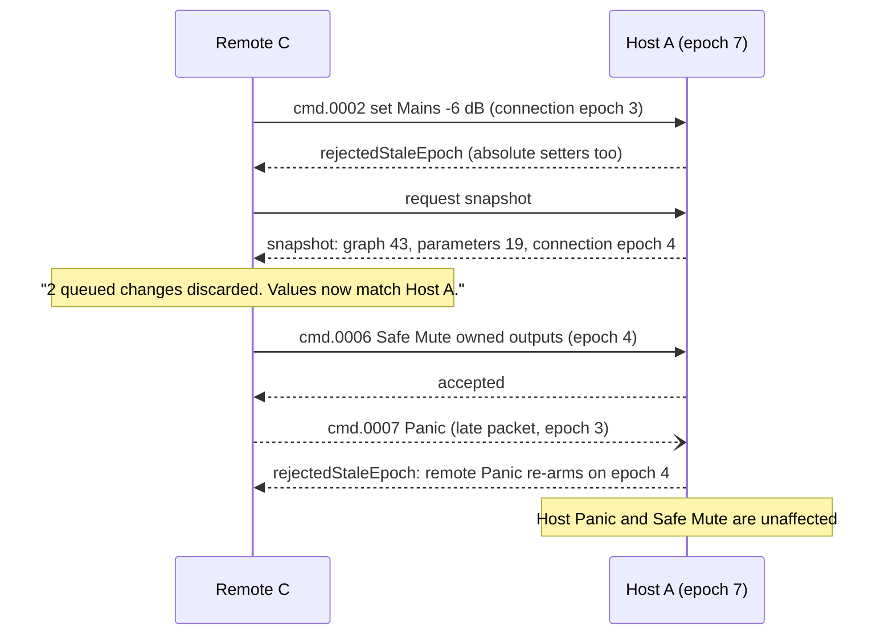

# Host and Remote Roles

Owner: #96 remote-controller-role (pairing and permissions #94, sync and commands #95, reconnect #97,
authority #62). Examples: `session.json` `roles`/`participants`/`lease`, `commands.json`,
`transport.json` `epochs`.

## Roles come from authority, not from screens

| Role | Permissions (from `session.json`) | Opens an engine | Example participant |
|---|---|---|---|
| Host | `live.set`, `draft.edit`, `activation.authorize`, `hazardous.authorize`, `device.configure`, safety | Yes (one lease) | `per.host-a` (Mac), `per.host-b` (**phone**) |
| Remote controller | `live.set:grp.fx`, `live.set:grp.out`, safety | **No** | `per.remote-c` (tablet) |
| Observer | Safety only | No | — |
| Assistant | `draft.propose`, `diagnostics.read` | No | `per.assistant` (local) |

- The role is chosen explicitly when a project is opened or a peer is paired. Form factor changes only
  the layout (`layoutAdaptations`), never the permissions.
- A phone host edits drafts and requests activation with the same review sheet as a Mac host
  (`cmd.0101` → `draftUpdated`, `cmd.0102` → `reviewRequired`). Hazardous edits need authorization
  on every host (`cmd.0103`).
- A remote's own MIDI controller produces **bound control intents**. They are sent as commands with the
  host epoch and the connection epoch. The remote never opens audio hardware for the host's set.

## What each role sees

```text
Host (any size)                    Remote controller                 Observer
+------------------------------+   +------------------------------+  +---------------------------+
| Example Set - HOST           |   | Remote for Host A - epoch 4  |  | Watching Host A           |
| Wiring | Perform | Spatial   |   | Perform (scoped)             |  | Status and meters only    |
| Draft, Review, Activate      |   | Effects  Outputs             |  |                           |
| Devices, Rig, Learn          |   | Structure: "Hosts edit       |  |                           |
|                              |   |   structure" (read-only)     |  |                           |
| [Safe Mute] [PANIC]          |   | [Safe Mute] [PANIC]          |  | [Safe Mute] [PANIC]       |
+------------------------------+   +------------------------------+  +---------------------------+
```

The role appears in the title, is announced on connect, and is listed under "Status > Peers". A
control outside the remote's scope is shown read-only with "Not in your permissions". It is not hidden,
so the remote user can still read the host's set.

## Epochs, stale intent and resnapshot



- Queued remote intent is **dropped**, never replayed, after a reconnect (`onReconnect:
  dropQueuedIntentAndResnapshot`). The remote says how many changes were discarded and does not re-send them on its own.
- Structural attempts from a remote are rejected precisely (`cmd.0003` → `rejectedPermission`).
- A stale-epoch remote Panic is rejected, as the roadmap's freshness rule requires. Whether to add a narrow
  exception is an open question for #55/#62 (see [README](README.md#open-questions-for-coordinators)).

## One engine lease per host

`lse.host-a` covers both `win.wiring` and `win.perform`. Other documents open on the same host stay
editable and preparable but never render on their own. Switching the leased document is an explicit
host action that goes through review when the graph differs.

## Non-drag, keyboard and VoiceOver paths

| Task | Path |
|---|---|
| Choose role on open/pair | Picker with text descriptions of each role's permissions; no default based on device size |
| See why a control is disabled | Focus the control: its hint says "Not in your permissions" or "Resyncing" |
| Discard and resync | Announced automatically; "Resync now" button and custom action |
| Hand over / revoke a remote | Host: Status > Peers > Remote C > "Revoke" (confirmation, not a drag) |

## States

| State | Remote UI | Host UI |
|---|---|---|
| Pairing | Code entry; nothing controllable | "Pair request from Remote C" [Allow] [Deny] |
| Connected | Scoped controls live | Peer listed with epoch |
| Resyncing | Inputs disabled with "Resyncing..." | Unchanged |
| Stale rejected | "N changes discarded" once | Diagnostic row, once |
| Pairing revoked | "Host A revoked this remote"; nothing is sent | "Remote C: revoked" |
| Host lease ended | "Host stopped the engine" | — |
| Disconnected | "Disconnected; nothing will be sent" | Peer greyed with text "Disconnected" |
