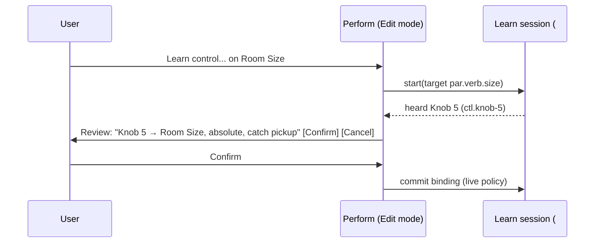

# Perform

Owner: #102 performance-panels (bindings #87, Learn #88, meter taps #66, telemetry transport #64, shell #99). Examples:
`parameters.json`, `project.json` `patches`, `commands.json` `cmd.0001`/`cmd.0005`/`cmd.0008`,
`session.json` `telemetry`. Contract owner: #55.

## Purpose

Play the active set. Perform edits **live-class parameters only**, through the same command envelope
as hardware and remotes. Structural edits are not available here; they open Wiring as a draft.
Prepared recalls switch patches or variations without rebuilding the graph.

## Regular layout

```text
+-- Perform - Example Set - Active rev 43 - Host epoch 7 ------------- [Edit] [Safe Mute] [PANIC] --+
| Recall: [Verse]  [Verse, wetter]  (prepared)        Tempo 96  Stopped   Actual rate: Unavailable  |
+-----------------------+-----------------------+-----------------------+---------------------------+
| Verb Mix              | Room Size             | Mains Level           | Space Width               |
| 30 %                  | 0.50                  | -8.0 dB  (ceiling 0)  | 0.50                      |
| [====------]          | [=====-----]          | [=======---]          | [=====-----]              |
| Knob 1 - STALE (Ctl A)| Learn: awaiting review| Encoder 2 - STALE     | Ctl B Fader 3 WAITING 0.20|
| Signal: no route      | Signal: no route      | Signal: -14.5 dBFS    | Signal: Unavailable       |
+-----------------------+-----------------------+-----------------------+---------------------------+
| Mic Trim (interface setting)  20 dB   Hazardous: changes need authorization     [Set value...]    |
+---------------------------------------------------------------------------------------------------+
```

`Signal` reads the measured telemetry for the control's route (`rte.mains`). Space Width shows
**Unavailable** because `rte.space` is Lost/Muted. A fader's own position is a control value, never a
signal meter (`par.mains.gain` telemetry is `faderTravelOnly` → Unavailable).

## Cell anatomy (one accessibility element)

| Part | Example | VoiceOver |
|---|---|---|
| Label, value, unit | Mains Level, −8.0, dB | "Mains Level, minus 8 decibels, adjustable" |
| Range and taper | −120…+6, ceiling 0, audio taper | Value hint: "Ceiling 0 dB" |
| Binding badge | Encoder 2 on Controller A: Stale (`bnd.enc2-mains`) | Custom action "Show binding" |
| Pickup | Waiting: hardware 0.20, value 0.50 (`bnd.fader3-width`) | Announced once: "Fader 3 waiting for pickup" |
| Controller feedback | Fader 3: unsupported by device; Knob 1: unavailable (stale) | Read in "Show binding" |
| Meter | Measured value or "Unavailable" with a reason | "Signal unavailable: device missing" |
| Class | Live / Hazardous | Hazardous adds "requires authorization" |

## Non-drag, keyboard and VoiceOver paths

| Task | Pointer/touch | Keyboard (proposed) | VoiceOver / Switch Control |
|---|---|---|---|
| Nudge value | Drag or scroll | Up/Down arrow; Shift for fine steps | Adjustable: swipe up/down |
| Exact value | Double-click value | Return on focused cell opens "Set value..." | Custom action "Set value..." |
| Reset to default | Context menu | Option-Return (proposed) | Custom action "Reset to 25 %" |
| Recall | Tap recall button | Command-1...9 (proposed) | Buttons in a "Recalls" container |
| Start Learn | Cell menu "Learn..." | L on focused cell, Edit mode only | Custom action "Learn control..." |
| Panic / Safe Mute | Toolbar | Shell-wide shortcuts owned by #99 | First items in the toolbar rotor |

Numeric entry clamps to range and ceiling, shows the unit, and says what will happen
("Clamped to ceiling 0 dB"). It never silently rounds a typed value.

## Bindings and controller feedback

Bindings are discoverable without touching hardware. "Bindings..." (Command-Shift-B, proposed) opens a list with
one row per binding: control, device and presence, target, group, pickup mode and state, and feedback
(`Sends feedback`, `Unsupported by device`, `Unavailable: controller stale`). Each cell's "Show binding" action
reads the same text. Controller A (`dev.ctl-a`) is stale, so its bindings stay listed as **Stale**, send no
input and receive no feedback until the device is seen again (`dgn.pads-stale` offers Rescan).

## Edit versus Perform

Perform hides layout handles and wiring affordances; it does not change permissions. Edit mode
arranges cells and starts Learn. Neither mode is selected by screen size: a phone host in Perform
mode is a full host with a single-column list of the same cells.

## Learn (review, never automatic)



Hazardous targets (`par.mic.trim`, `learnExcludedByDefault`) are not offered unless the user
explicitly includes them in the review. `lrn.trim` stays `blocked` until then. Cancel leaves no
partial binding behind.

## States

| State | Trigger (example) | Cell shows | Input result |
|---|---|---|---|
| Engaged | `bnd.fader3-width` after pickup catches | Binding badge | `accepted`, parameter rev +1 |
| Stale controller | `bnd.knob1-mix`, `bnd.enc2-mains` | "STALE" badge; on-screen control still works | No input from the device; host UI edits accepted (`cmd.0001`) |
| Waiting for pickup | hardware 0.20 vs value 0.50 | "Waiting 0.20 → 0.50" | `heldForPickup` (`cmd.0005`) |
| Hazardous | `par.mic.trim` | Lock + "Set value..." | `needsAuthorization` (`cmd.0008`), sheet bound to epoch |
| No target | Node removed in a draft | "No target in active rev" | Disabled with reason |
| Not permitted here | Remote outside `grp.fx`/`grp.out` | Value read-only + "Not in your permissions" | `rejectedPermission` |
| Resyncing | New epoch on a remote | "Resyncing..." | Input queued nowhere; stale intent dropped |
| Missing plugin | A control on `nod.echo` (Missing) | "Plugin missing: value kept" | Edits stored, nothing rendered |
| Meter unavailable | Lost route, unmapped role, no telemetry | "Unavailable" + reason | n/a |

## Contract seams

Reads: parameters, bindings, pickup, telemetry, recalls. Writes: live-class commands with
`expectedParameterRevision` and the current epoch; hazardous commands request authorization (#62);
Learn writes go through #88 review. Media cues and chart sync are deferred to #53.
