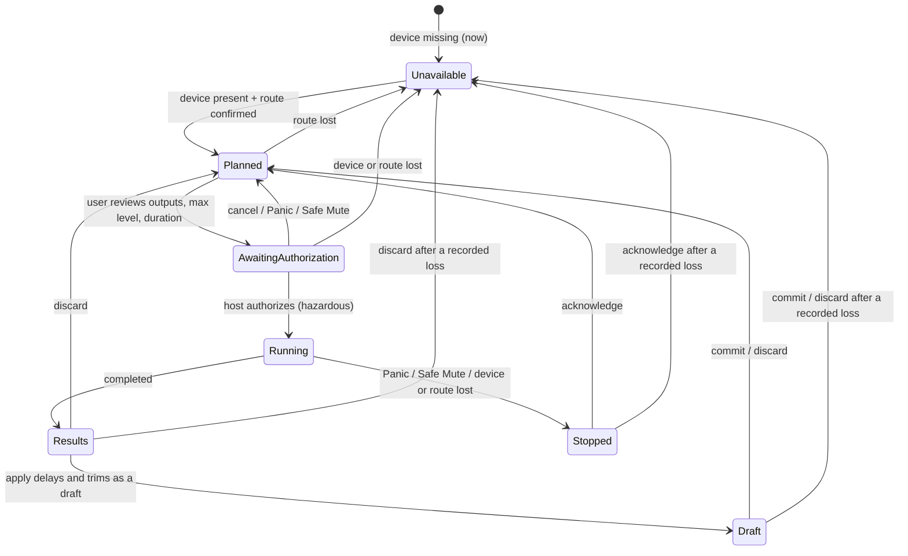

# Spatial

Owner: #116 spatial-ui-motion (model adapter #114, DBAP/masks/calibration signals #115, routes #55/#100). Examples:
`graph.json` `spatial`, `devices.json` `rte.space`, `parameters.json` `par.space.width`,
`session.json` (`nod.space` Lost/Muted, `dgn.space-lost`).

## Purpose

Place sources in a neutral room space and manage speakers, masks and calibration. Speaker
**identity** (`spk.fl`...) is portable layout data. The **route** to device channels (`rte.space` on
`dev.iface-b`, channels 0–3) is host-local and shown separately. Source position and width are live
parameters. Layout, masks and routes are structural and go through a draft.

## Regular layout

```text
+-- Spatial - Layout: Quad (synthetic) - Space: LOST / MUTED - [Safe Mute] [PANIC] --------------+
| Room (front is up)                           | Selected: Soft Synth (src.synth)                |
|    [FL]                              [FR]    |  X  [ 0.20 ]  right of centre                   |
|                                              |  Y  [ 0.40 ]  in front                          |
|                                              |  Width [ 0.50 ]                                 |
|                        (S)                   |  [Move to speaker...] [Centre]                  |
|                     <-width->                |-------------------------------------------------|
|                     + centre                 | Speakers        Route (this host)    State      |
|                                              |  Front Left     Interface B ch 1     Lost       |
|                                              |  Front Right    Interface B ch 2     Lost       |
|                                              |  Rear Left      Interface B ch 3     Lost       |
|                                              |  Rear Right     Interface B ch 4     Masked     |
|    [RL]                              [RR] x  |                                                 |
| Mask: Rear Right muted. Survivors are not boosted.  Meters: Unavailable (device missing)       |
+----------------------------------------------+-------------------------------------------------+
```

The room plane is one of three equivalent editors: the plane, the numeric fields, and the
speaker list. `x` marks a masked speaker; the text label carries the same state.

## Non-drag, keyboard and VoiceOver paths

| Task | Pointer/touch | Keyboard (proposed) | VoiceOver / Switch Control |
|---|---|---|---|
| Move source | Drag (S) | Arrows move 0.05; Shift-arrows 0.01 | Two adjustable elements, "X" and "Y", each with a spoken position |
| Exact position | — | Tab to X/Y/Width fields | Fields with units and range |
| Snap to speaker | — | "Move to speaker..." picker | Custom action "Move to Front Left" |
| Mask speaker | Speaker menu | Space on focused speaker row | Custom action "Mute speaker (draft)" |
| Remap route | — | "Change route..." on the row | Opens the rig picker (#100), review required |
| Authorize calibration | Sheet buttons | Tab through outputs, max level, duration; Escape cancels; Command-Return authorizes (no default button) | Sheet is a modal container; summary is read first; "Authorize test signal" is the last element |

Source element: *"Soft Synth, slightly right of centre, in front; x 0.10, y 0.60, width 0.50"*. Rotors:
**Sources**, **Speakers**. Positions are always spoken as words plus numbers, never only as coordinates.

### Spoken positions and edits

Each axis is read as words, then the exact numbers (`SpatialPositionDescription`, #116 PL1). Right is +x and
front is +y.

| Printed value (absolute) | x words | y words |
|---|---|---|
| below 0.05 | centre | centre |
| 0.05 to 0.34 | slightly left/right of centre | slightly behind/in front |
| 0.35 to 0.74 | left/right of centre | behind/in front |
| 0.75 and above | far left/far right | far behind/far in front |

- The band comes from the printed hundredths (rounded half away from zero), so the words always agree with the
  numbers: 0.0499 prints 0.05 and is "slightly". Each edge belongs to the outer band.
- The plain x band says "right of centre", not "right", to match "slightly right of centre".
- Format: `<x words>, <y words>; x <x>, y <y>`, two decimals, never "-0.00". If both axes are centre, the words
  collapse to "centre": "centre; x 0.00, y 0.00". A stereo source adds ", width 0.50"; a mono source has none.
- Arrows, drags and the VoiceOver adjustable actions share one edit path. Nudges and drags clamp at ±1. Exact
  entry refuses out-of-range or non-finite values instead of clamping, and stores −0.0 as 0.
- Width follows the same rules on stereo sources only. Width edits on a mono source are refused, the UI hides
  the Width control for mono sources, and a mono source has no spoken Width value.

## Masks and survivors

Muting a speaker never raises the others (#115 renders masks). `renormalizeSurvivors: false` is the default
and appears as the text "Survivors are not boosted". Turning renormalization on is an explicit structural
draft, staged under ceilings, that shows its level change in review.

## Legacy coordinate transform

Today `Speaker.position` and `SpatialSource.position` use 0…1 with Front L at (0,0) and y growing toward the
rear (`SpeakerArray.swift`, `SpatialSource.swift`). The draft space is −1…1 with front = +y. Import maps
**x′ = 2x − 1, y′ = 1 − 2y**, so the standard quad FL (0,0) → (−1, 1) and RR (1,1) → (1, −1). Distances double,
so unit-space constants must double too or the existing DBAP golden outputs change: `SpatialPanner.spatialBlur`
0.15 → 0.30, the `channelPlacements()` width offset `width × 0.25` → `width × 0.5`, and the 0…1 clamp → −1…1.
The y-flip does not change distances. A legacy stereo source (`left`/`right` `WingNodeRef`) becomes one source
on a 2-channel port. Its console references are evidence only, and the import stays inert until reviewed.

### Neutral layout contract (v1)

`SpatialLayout` (`fluxklang.spatial-layout` v1, `Shared/Spatial/Adapter/`) holds at most 64 speakers and 64 groups;
an import result holds at most 64 sources. Decoding re-validates every value and refuses invalid data with a typed
`SpatialLayoutError`. Points outside −1…1 are refused (`.coordinateOutOfRange`), and a source placement's `blur` outside
**1e-3…2√2** neutral units, or non-finite, is refused with `.invalidBlur`. The upper bound is the plane diagonal; the
lower bound is policy against degenerate near-zero blur. Imported legacy blur is always 0.30.

### Render planning (M1)

`SpatialRenderer` (`Shared/Spatial/Render/`) is a control-rate planner. It runs off the audio thread and
allocates; the allocation-free execution path and the mapping to device channels come later. A plan is a gain
matrix: one row per source channel, in source order, and one column (output) per layout speaker, in layout order.
Each gain is finite and within 0…1. The pipeline is the neutral DBAP law, then masks, then optional
renormalization, then the trim.

- **Masks:** a muted speaker, or a speaker that is not soloed while another is, gets exactly 0, and every
  survivor keeps its law gain. Mute wins over solo, so if every soloed speaker is also muted the output is
  silent. A speaker whose route is missing on this host is **lost**, which only zeroes it. Masks are capped at
  128, one mute and one solo per speaker.
- **Renormalization:** `renormalizeSurvivors` is off by default. When on, it rescales the survivors of a mute
  or solo by `min(1/√P, 2)`, where P is the survivors' power, so the boost is at most +6.02 dB and never above
  unit power. Route loss never triggers renormalization.
- **Calibration:** each speaker has a trim of −60…0 dB (attenuation only) and a delay of 0–50 ms. The delay is
  rounded half-up to whole frames at a sample rate of 8–384 kHz. A plan reads one applied
  `SpatialCalibrationSet` and records its non-negative generation. A pending set is staged at exactly the
  applied generation + 1 and has no effect until `promote` swaps it in whole.
- **Ramps:** `SpatialGainRamp` interpolates linearly between two plans over 0–48,000 frames. Both plans need
  identical row sources and identical ordered speaker IDs; a layout reorder or membership change is refused
  (`columnMismatch`) and needs a fresh plan (a jump). ID-aligned ramps are an M2 follow-up. Frames before 0
  give the start plan; frames from the duration on (so any frame ≥ 0 of a 0-frame ramp) give the end plan,
  and no frame yields NaN. Linear amplitude dips in power mid-ramp (to about −3 dB between disjoint speakers)
  and never rises above the endpoints.
- **Silence:** any refusal is typed (`SpatialRenderError`), and `planOrSilence` returns all-zero gains of the
  request's shape alongside the error.

## Calibration (staged and authorized)



The diagram shows phase changes only. Revising a plan, reporting progress, and recording a route loss or
confirmation while Results, Stopped or Draft are shown keep the phase. "Device lost" is a device-loss stop or
`routeLost`; "route lost" is `routeLost` alone. A recorded loss is one that stopped the run, or a `routeLost`
received in Results, Stopped or Draft, with no route confirmation after it.

- No test signal plays without the authorization sheet. There are no automatic tones on launch or reconnect.
- The model (`SpatialCalibrationFlow`, #116 PL1) has no clock and plays nothing. Route status, elapsed time and
  measured results are injected.
- Each flow has a caller-supplied ID, which must be unique to that flow instance (a flow rebuilt after relaunch
  gets a new one). A flow must not be snapshotted and restored while it awaits authorization, because the
  restored copy would accept the same authorization again. Single-use consumption of authorizations comes with
  the #62 hazardous-action tokens.
- An authorization binds the flow ID, the whole reviewed plan and the review generation. The flow checks the
  flow ID, the plan ID, the rest of the plan, then the generation; the first mismatch is refused and nothing
  changes. The plan includes the outputs in order, each output's route, the maximum level and the duration, so
  re-routing a speaker needs a new review. The plan's digest is a 64-bit FNV-1a summary for display and logs.
  It is not cryptographic and does not resist an adversary; the binding compares the whole plan, not the digest.
- Running completes only when the injected elapsed time equals the plan's total; earlier results are refused.
- Panic, Safe Mute and device loss stop a running calibration. While a review awaits authorization they cancel
  it to Planned (Unavailable after a device loss); the next review gets a new generation, so the old
  authorization is refused. Outside Running and AwaitingAuthorization they are idempotent no-ops: they never
  fail and report that nothing was playing, so Panic can be broadcast without error handling. A device-loss
  stop there records nothing, so hosts must also send `routeLost` for the loss to move Planned to Unavailable
  or to be recorded in Results, Stopped or Draft.
- A route loss while results, a stop or a draft are shown keeps them on screen (a draft can still be committed
  or discarded) and records the loss, as does the device loss that stopped a run. Leaving then lands in
  Unavailable with the loss reason instead of Planned. A route confirmation after the loss clears it, and
  leaving lands in Planned with the newly confirmed plan. Only one confirmation follows a loss: a second
  confirmation, or one without a loss, is refused as an illegal transition until another `routeLost` arrives.
- Results are staged as a pending calibration set at the applied generation + 1. Only an explicit commit
  applies them.
- Provisional policy: the maximum test level is −60…−6 dBFS and each output plays for 0.25…10 s, both
  inclusive, with at most 64 outputs. The longest run is 64 × 10 s ≈ 10.7 minutes.
- Results are labelled **relative, uncalibrated**. There are no SPL or "room corrected" claims without a measured reference.
- Today `dev.iface-b` is missing, so the Calibrate button is disabled with the reason "Interface B missing".

## States

| State | Trigger (example) | Plane | Panel | Audio |
|---|---|---|---|---|
| Active | Route confirmed, device present | Normal | Measured meters | Rendered |
| Lost/Muted | `rte.space` `deviceMissing` | Dimmed + "LOST / MUTED" | Rows say Lost | Muted; edits stay draft or live-parameter only |
| Unmapped | No route for `rol.space` | Normal | "Map outputs..." | Nothing rendered |
| Masked speaker | `spk.rr` muted | `x` + label | "Masked" | Survivors unchanged |
| Missing source | Upstream plugin Missing | Source hollow | "Source silent: plugin missing" | Silent |
| Draft layout | Speaker moved or added | Ghost position + "Draft" | Review bar | Unchanged until commit |

## Timing

UI frames never clock DSP. This surface defines no timing: automation and gesture arbitration belong to
#108 and media-synchronized motion to #53. The display shows positions sampled from telemetry or parameter
state at whatever rate it can draw. Reduce Motion replaces trails with the current position.

## Contract seams

Reads: `graph.json` spatial layouts/sources/masks, routes, telemetry. Writes: live commands for
`par.space.width` and positions; draft ops for layouts, masks and renormalization; route changes go
through the rig flow (#100). Calibration authorization uses #62.
