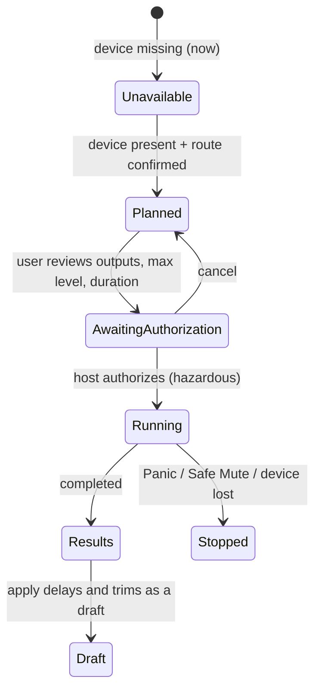

# Spatial

Owner: #116 spatial-ui-motion (model adapter #114, compile #66, routes #55/#100). Examples:
`graph.json` `spatial`, `devices.json` `rte.space`, `parameters.json` `par.space.width`,
`session.json` (`nod.space` Lost/Muted, `dgn.space-lost`).

## Purpose

Place sources in a neutral room space and manage speakers, masks and calibration. Speaker
**identity** (`spk.fl`...) is portable layout data. The **route** to device channels (`rte.space` on
`dev.iface-b`, channels 0–3) is host-local and shown separately. Source position and width are live
parameters. Layout, masks and routes are structural and go through a draft.

## Regular layout

```text
+-- Spatial - Layout: Quad (synthetic) - Space: LOST / MUTED - [Safe Mute] [PANIC] --------------+
| Room (front is up)                           | Selected: Soft Synth (src.synth)                |
|    [FL]                              [FR]    |  X  [ 0.20 ]  right of centre                   |
|                                              |  Y  [ 0.40 ]  in front                          |
|                                              |  Width [ 0.50 ]                                 |
|                        (S)                   |  [Move to speaker...] [Centre]                  |
|                     <-width->                |-------------------------------------------------|
|                     + centre                 | Speakers        Route (this host)    State      |
|                                              |  Front Left     Interface B ch 1     Lost       |
|                                              |  Front Right    Interface B ch 2     Lost       |
|                                              |  Rear Left      Interface B ch 3     Lost       |
|                                              |  Rear Right     Interface B ch 4     Masked     |
|    [RL]                              [RR] x  |                                                 |
| Mask: Rear Right muted. Survivors are not boosted.  Meters: Unavailable (device missing)       |
+----------------------------------------------+-------------------------------------------------+
```

The room plane is one of three equivalent editors: the plane, the numeric fields, and the
speaker list. `x` marks a masked speaker; the text label carries the same state.

## Non-drag, keyboard and VoiceOver paths

| Task | Pointer/touch | Keyboard (proposed) | VoiceOver / Switch Control |
|---|---|---|---|
| Move source | Drag (S) | Arrows move 0.05; Shift-arrows 0.01 | Two adjustable elements, "X" and "Y", each with a spoken position |
| Exact position | — | Tab to X/Y/Width fields | Fields with units and range |
| Snap to speaker | — | "Move to speaker..." picker | Custom action "Move to Front Left" |
| Mask speaker | Speaker menu | Space on focused speaker row | Custom action "Mute speaker (draft)" |
| Remap route | — | "Change route..." on the row | Opens the rig picker (#100), review required |

Source element: *"Soft Synth, slightly right of centre, in front, width 0.5."* Rotors: **Sources**,
**Speakers**. Positions are always spoken as words plus numbers, never only as coordinates.

## Masks and survivors

Muting a speaker never raises the others. `renormalizeSurvivors: false` is the default and appears
as the text "Survivors are not boosted". Turning renormalization on is an explicit structural draft
that shows its level change in review.

## Calibration (staged and authorized)



- No test signal plays without the authorization sheet. There are no automatic tones on launch or reconnect.
- Results are labelled **relative, uncalibrated**. There are no SPL or "room corrected" claims without a measured reference.
- Today `dev.iface-b` is missing, so the Calibrate button is disabled with the reason "Interface B missing".

## States

| State | Trigger (example) | Plane | Panel | Audio |
|---|---|---|---|---|
| Active | Route confirmed, device present | Normal | Measured meters | Rendered |
| Lost/Muted | `rte.space` `deviceMissing` | Dimmed + "LOST / MUTED" | Rows say Lost | Muted; edits stay draft or live-parameter only |
| Unmapped | No route for `rol.space` | Normal | "Map outputs..." | Nothing rendered |
| Masked speaker | `spk.rr` muted | `x` + label | "Masked" | Survivors unchanged |
| Missing source | Upstream plugin Missing | Source hollow | "Source silent: plugin missing" | Silent |
| Draft layout | Speaker moved or added | Ghost position + "Draft" | Review bar | Unchanged until commit |

## Timing

UI frames never clock DSP. Motion and automation are rendered against the audio clock (`clk.sample`).
The display shows positions sampled from telemetry or parameter state at whatever rate it can draw.
Reduce Motion replaces trails with the current position. Media-synchronized motion is deferred to #53.

## Contract seams

Reads: `graph.json` spatial layouts/sources/masks, routes, telemetry. Writes: live commands for
`par.space.width` and positions; draft ops for layouts, masks and renormalization; route changes go
through the rig flow (#100). Calibration authorization uses #62.
